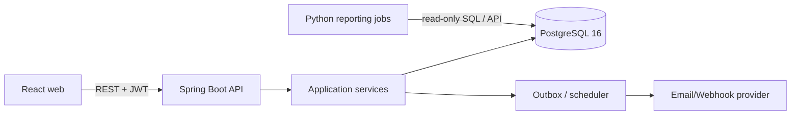

# Architecture

Modules: `identity`, `tenant`, `catalogue`, `partners`, `purchasing`, `sales`, `inventory`, `reporting`, `audit`, and `platform`. Controllers accept DTOs, services enforce permissions and transactions, repositories always scope by `company_id`, and Flyway owns schema evolution.

```mermaid
sequenceDiagram
 participant UI
 participant API
 participant S as InventoryService
 participant DB
 UI->>API: POST dispatch + Idempotency-Key
 API->>S: validated command + principal tenant
 S->>DB: begin; lookup idempotency
 S->>DB: SELECT balance FOR UPDATE
 S->>DB: validate available; insert movement/line; update cache
 S->>DB: insert idempotency; commit
 API-->>UI: 201 movementId
```
Authentication uses an OIDC-compatible issuer in production. JWT claims carry user identity; company membership and permissions are resolved server-side. Never trust a client-supplied company without matching membership.

Deploy separate containers behind an HTTPS reverse proxy. Development uses Compose, staging mirrors production with smaller resources, production uses managed PostgreSQL with point-in-time recovery, two or more API replicas, static web hosting/CDN, central logs, Prometheus metrics and alerting.
