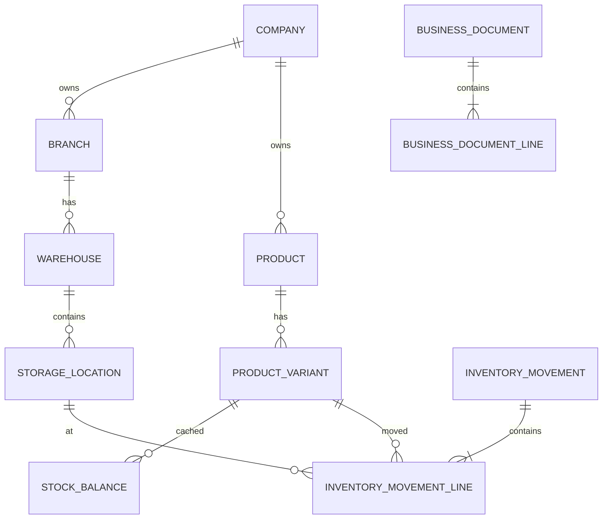

# Data model and ledger policy

All tenant-owned tables include `company_id`. UUID primary keys avoid cross-site collisions. Natural identifiers are unique within tenant boundaries. `numeric(19,6)` represents quantities and `numeric(19,4)` money/cost. Posted documents and movements are immutable at the service boundary; corrections reference the original movement and negate it.

Quantity definitions: on-hand is posted physical IN minus OUT at locations; reserved is active allocation not yet dispatched; available is `on_hand - reserved`; damaged/expired are on-hand in typed locations; in-transit is on-hand in TRANSIT locations. `stock_balance` is a transactionally maintained projection for fast reads and can be rebuilt from movement lines. Weighted-average unit cost after receipt is `(old_qty*old_avg + receipt_qty*receipt_cost)/(old_qty+receipt_qty)`; issues use the pre-issue average. Physical movement and valuation records remain logically separate.

Deletion: master data with transactions is deactivated, not deleted. Child-only drafts may cascade through application-controlled deletion. Ledger FKs restrict deletion. Indexes lead with company and common filters.
